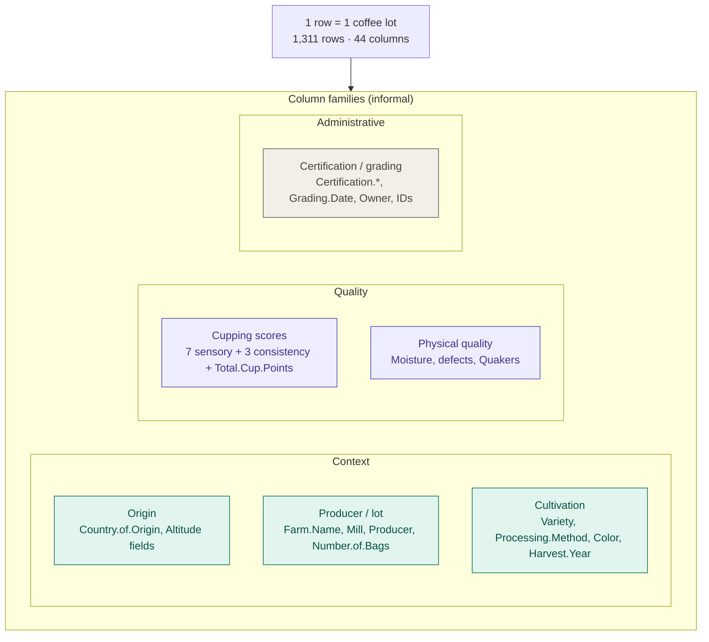

# What makes a great arabica coffee? An exploratory data analysis

Exploratory data analysis (EDA) of professionally graded arabica coffee lots, with a focus on **data cleaning** and on **how the choice of chart changes the conclusions**.

> Course project: Introduction to Data Science, ISSAT Sousse (ING-A3). The notebook is written in French.

## Research question

What distinguishes a high-quality arabica lot: its country of origin, its altitude, its processing method, its defects? And how much do cleaning and chart choices change the conclusions compared with a raw reading of the data?

## Dataset

Coffee Quality Database, built from reviews published by the Coffee Quality Institute (CQI). It describes about 1,300 arabica lots graded by professional tasters (origin, variety, processing method, altitude, defects, 10 cupping scores and a total score).

The data file is **not included** in this repository. Download `arabica_data_cleaned.csv` from the [original GitHub repository](https://github.com/jldbc/coffee-quality-database) or from the [Kaggle copy](https://www.kaggle.com/datasets/volpatto/coffee-quality-database-from-cqi), and place it in the same folder as the notebook.

### Dataset at a glance

- 1 row = 1 coffee lot; 1,311 rows and 44 columns in the raw file.
- The notebook keeps 25 columns and 1,310 rows after dropping the never-graded lot (`Total.Cup.Points = 0`).
- The families below are an informal reading aid, not an official CQI schema.



## What the notebook does

1. **Presentation**: selecting the columns relevant to the research question.
2. **Diagnosis** before any correction: types, descriptive statistics, missing values, duplicates, inconsistencies, outliers (IQR and z-score).
3. **Cleaning**, with each decision justified:
   - one lot with a total score of 0 (never evaluated) removed;
   - impossible altitudes and zero humidity values set to missing instead of dropping the rows;
   - text and date formats harmonised;
   - no imputation of altitude, after checking that missing values do not bias the score.
4. **Univariate analysis** of the score and of the countries.
5. **Bivariate and multivariate analysis**: score components, country, altitude, processing method, year, defects, atypical lots.
6. **Conclusion** and limits of the study.

A recurring theme: several questions are treated twice, with a weak chart and a stronger one (for example a pie chart versus sorted bars, or a bar of means versus box plots), to show how the representation changes the conclusion.

## Main findings

- The total score is concentrated (median 82.5), with a tail of low-scoring lots; 78.2 % of lots are in the "specialty" class and 8.1 % in the "excellent" class.
- Country matters mostly through the **consistency** of its lots: Ethiopia has the best lots, Colombia is the most consistent.
- Altitude is modestly associated with the score (r = 0.23), partly because of a country effect.
- No processing method is better overall: the global gap of 0.39 points changes sign depending on the country.
- Defects only lower the score beyond roughly 6 category-2 defects.
- Atypical lots are real cases, not errors, and should be kept.

The study describes associations and does not claim causality. Limits are discussed at the end of the notebook.

## Tech stack

Python, pandas, NumPy, Matplotlib, Seaborn (pandas 2 or later, seaborn 0.13 or later).

## Run it

```bash
pip install -r requirements.txt
jupyter notebook
```

Open `eda_arabica_coffee.ipynb` and run all cells. You can also open it in Google Colab and upload `arabica_data_cleaned.csv` to the session.
